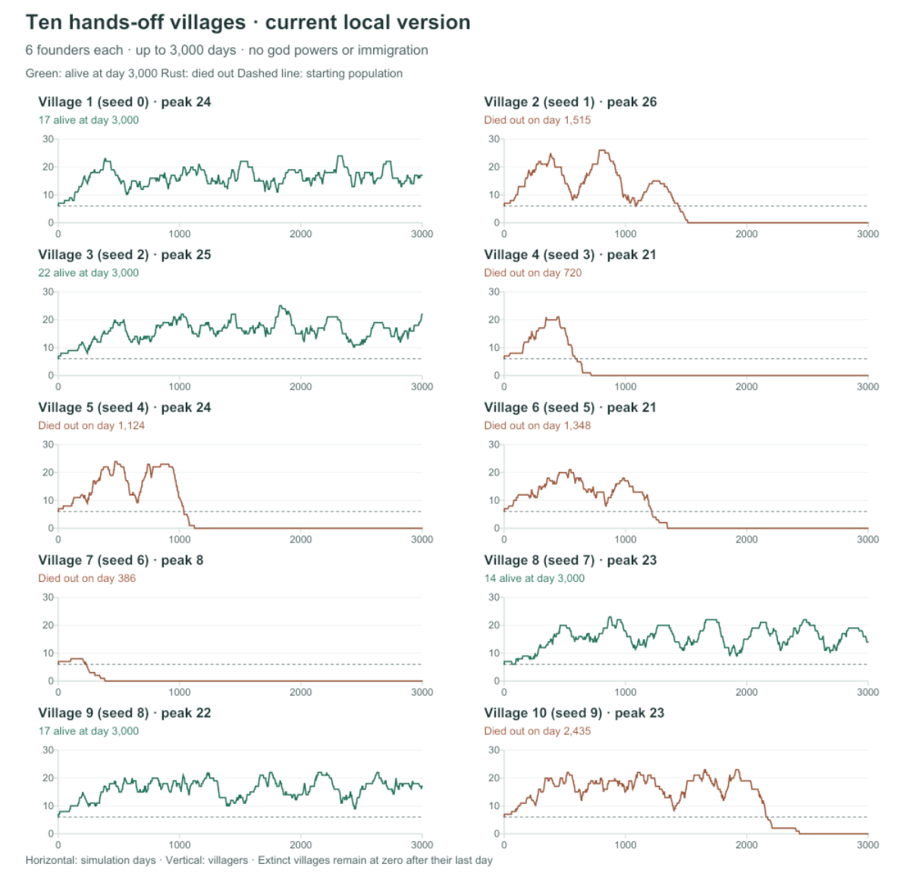

# Population growth audit — 14 November 2026

Ten new, hands-off villages using the current local code, seeds 0–9, six
founders each. Each ran until extinction or day 3,000. No god commands,
immigration, magic unlock, resource gifts or rule changes were applied.
The rules include the current needs hierarchy, individual knowledge/teaching,
fishing, healer succession, bone fertilizer and physical site clearing.

**Finding:** villages can grow into the low twenties, but replacement across
generations is unreliable. The largest avoidable restriction is inconsistent
food accounting in the birth check. Chronic hunger, cold, poor mood and child
deaths do not explain the observed stagnation in these ten runs.

## Outcomes

| Village (seed) | Peak | Alive day 1,000 | Births | Outcome |
|---|---:|---:|---:|---|
| 1 (0) | 24 | 16 | 169 | 17 alive at day 3,000 |
| 2 (1) | 26 | 10 | 69 | Extinct day 1,515 |
| 3 (2) | 25 | 21 | 168 | 22 alive at day 3,000 |
| 4 (3) | 21 | 0 | 23 | Extinct day 720 |
| 5 (4) | 24 | 11 | 52 | Extinct day 1,124 |
| 6 (5) | 21 | 17 | 54 | Extinct day 1,348 |
| 7 (6) | 8 | 0 | 3 | Extinct day 386 |
| 8 (7) | 23 | 18 | 156 | 14 alive at day 3,000 |
| 9 (8) | 22 | 18 | 163 | 17 alive at day 3,000 |
| 10 (9) | 23 | 15 | 117 | Extinct day 2,435 |

Eight survived to day 1,000; four survived to the observation limit. The four
survivors are censored at day 3,000, not proven permanently sustainable.
This is a small deterministic sample, not a reliable estimate of all seeds.

The ten runs produced **974 births and 964 deaths**. Of those deaths, **951
(98.7%) involved old age**, 13 involved illness, and none involved hunger or
cold. One villager died before adulthood. Of those born, 968 were observed
alive at adulthood and five were still children when observation ended.



## 1. Preserved food is usable for meals but ignored when deciding to have children

The actual birth check requires the main food counter to hold
`2 × current population + 4` after today's meals. It does not count the
preserved food in `local.campStores[camp].saved`.

Meals can draw on that local store, and `assessNeeds` counts local saved food
when judging household security. Preserving food can therefore make villagers
feel secure while making the birth check report inadequate supplies. The
main food counter already includes some dried food; the omission concerns
the separate camp-store stock, not every preserved item.

Across **19,522 actual birth checks**:

- Food blocked the check on **13,925 days (71.3%)**.
- Food was the only unmet condition on **12,963 days**.
- On **11,566 of those days (89.2%)**, adding just the prospective parents'
  own camp's finished preserved food would have met the current food threshold.
  This conservative check does not pool abandoned stores or food from other camps.
- Counting saved food in all currently occupied camps would cover 11,784 of
  those days; pooling every camp's stock would cover 12,254. Those broader
  sums require access/transport rules and are not interchangeable with local food.

These are daily condition checks, not a count of babies that would definitely
have been born after changing the rules. New births would change subsequent
food consumption, work, relationships and housing demand.

**Recommendation:** use a shared definition of accessible, edible provisions
for needs, meals and family readiness. Count finished food at the parents'
camp while respecting other camps' access and the eastern settlement's
separate supplies. Keep food costs, reserves, parental conditions and recovery.
Do this before increasing yields or lowering food requirements.

Code: `src/sim.js`, `resolveLivesAndDiscovery`, `meals`, `seasonalStores`;
`src/needs.js`, `assessNeeds`.

## 2. Short reserve fluctuations erase family readiness

Births require three consecutive qualifying days. Any failed condition resets
the single village-wide counter to zero. There were **1,333 broken streaks**;
food failed on **1,321 (99.1%)** of those resets. Some conditions overlap.

**Recommendation:** first fix food accounting and rerun the same seeds.
If readiness is still excessively fragile, let one brief supply dip pause
progress rather than erase it. Sustained shortage, illness, losing the partner
or inadequate shelter should still prevent births. Keep the three-day readiness
period and seven-day maternal recovery initially; an instant-birth rule is
not justified by these measurements.

## 3. A small village can reach a housing/birth deadlock

Capacity blocked only **439 checks (2.2%)** overall, so larger population caps
are not the main answer. However, Village 7 stayed at eight places with no huts
and hit the cap on 104 days.

The construction decision looks for population above shelter capacity or a
locally crowded camp. Once eight residents split into camps of six and two,
neither camp met the crowding threshold, and eight was not above the global
eight-place capacity. Births could not exceed the cap to create the condition
that would trigger construction. A direct replay confirmed this state on
days 150 and 200; the camp already had a hand axe.

**Recommendation:** plan one modest hut when only one or two sleeping places
remain, provided food, tools, materials and a qualified worker permit it.
Keep physical site clearing, construction work and costs. Avoid granting
unbuilt beds or increasing the cap independently of structures.

## 4. Small closed populations can run out of unrelated partners

No ready pair blocked **1,440 checks (7.4%)**. Within those checks, 653 had no
unrelated opposite-sex pair anywhere among reproductive-age adults, and 469
lacked one of the sexes in that age range. Other causes included maternal
recovery and parental condition. The close-relative check excludes parents,
children and siblings; this is not a full genetic model.

Village 6 illustrates the problem: by day 1,300 its last two residents were a
healthy brother and sister, aged 140 and 122. Both had health and happiness
100. More food or healing could not provide them with an unrelated partner.
Village 2 similarly reached day 1,300 with an elderly father and 13 of his
children, all at health and happiness 100.

Cross-camp movement to seek a partner already exists. Only three checks in
the audit's demographic classification fell into the remaining camp/region
category; simply making villagers swap camps more often is unlikely to solve
the main restriction. The existing preference for parents with fewer children
also cannot help when other family lines have disappeared.

**Recommendation:** after the food and housing corrections, consider rare,
earned contact with another community: one or two prospective settlers,
widely spaced, with a discovered route, friendly contact, spare shelter and
adequate provisions. They should physically travel and choose to join.
This is a proposed future mechanism, not something tested in these runs.
Preserve the close-relative restriction and avoid continuous free arrivals.

## 5. Broad health, mood and mortality buffs would target the wrong problem

There were **zero reproductive-adult days below the happiness threshold**.
Relaxing only the health requirement from 70 to 60 would have enabled merely
three additional instantaneous checks with food and space already available.
Those are not projected future births.

The game becomes reproductive at age 20, stops accepting parents at age 240,
and removes villagers at age 300. These are simulation ages, not historical
human demographic estimates. Healthy people commonly aged out while younger
replacement families were too sparse or related. Raising health, making
everyone happier or extending lifespan would obscure the supply and family
formation issues without addressing their causes.

## Suggested order of work

1. Correct accessible-food accounting and repeat the same ten seeds.
2. Add a small forward-looking housing buffer, with actual NPC building work.
3. Measure whether unrelated family lines remain viable. Add occasional
   community contact only if the closed-population trap persists.
4. Consider limited birth-readiness smoothing only after the accounting fix.

Judge improvements by continued births across generations, fewer collapses,
stable provisions and continued construction—not just a higher peak. New
births must create real food, care and housing demand. No balance change has
been applied by this audit, and none of the recommendations is yet a measured
changed-rule survival result.

## Reproduction and validation

Source SHA-256:
`1aa980f253e9e3aeea5940c17944c66c148590854fadf0417a28fc852900dbbb`

The audit hashes the decision modules listed in the JSON, checks that they
stay unchanged during measurement, and observes the actual decision just
before the birth counter changes. It records deaths before dead villagers
are removed. Observation calls are inserted into an in-memory copy; live
source files and player saves are untouched. The instrumented and original
simulation match state for state for the first 100 days of seed 0. Independent
uninstrumented full replays of seeds 0 and 6 also matched births, deaths,
peak population and final population exactly.

The same ten seeds were replayed to refine the cache-access diagnostic; they
are still ten distinct villages, not twenty independent samples.

```
node scripts/population-audit.mjs 10 3000 population-audit-10-20261114
```

`scripts/population-audit-plot.py` generates the standalone SVG with ReportLab.
The PNG is a native Canvas rasterization of that figure. CSV summary, daily
CSV and detailed JSON share this report's filename prefix. Daily population
in the CSV is measured after deaths and before that day's birth; the summary
and trajectory snapshots use the completed day's population. Percentages of
blocked checks overlap and must not be added. The final extinction day has
no birth check, because no villagers remain.
